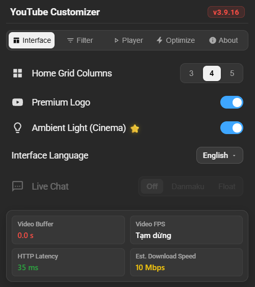

<div align="center">

# YouTube Customizer

**Comprehensive Userscript for YouTube UI Customization, Performance Optimization & Intelligent Player Controls**

[Tiếng Việt](README.md) · [English](README_EN.md)

[](https://www.tampermonkey.net/)
[](https://developer.mozilla.org/en-US/docs/Web/JavaScript)
[](https://www.w3.org/Style/CSS/)
[](https://github.com/huyvu2512/youtube-customizer)
[](./LICENSE)

[](https://github.com/huyvu2512/youtube-customizer/stargazers)
[](https://github.com/huyvu2512/youtube-customizer/forks)
[](https://github.com/huyvu2512/youtube-customizer/issues)
[](https://github.com/huyvu2512/youtube-customizer/commits/main)


[Install Script](https://raw.githubusercontent.com/huyvu2512/youtube-customizer/main/tampermonkey.user.js) · [Changelog](CHANGELOG.md) · [Report Bug](https://github.com/huyvu2512/youtube-customizer/issues) · [Request Feature](https://github.com/huyvu2512/youtube-customizer/issues)

</div>

---

<div align="center">
  
</div>

---

## Introduction

**YouTube Customizer** is a high-performance Userscript running on Tampermonkey / Violentmonkey, engineered to deliver a clean, distraction-free, and immersive YouTube viewing experience. Designed and developed by Huy Vũ (@huyvu2512), this project serves as an in-depth exploration of advanced DOM manipulation, video player rendering pipeline optimization, and fine-tuned browser event interactions on YouTube.

Release **v3.9.26** opens updates only after a user action and removes timed page reloads. See [CHANGELOG.md](CHANGELOG.md) for details.

---

## Key Features

- **Ambient lighting (Ambilight)** - Adds a frame-based glow on standard video watch pages. It is off by default and does not run on Shorts.
- **Five-tab settings panel** - Settings for layout, filters, player, optimization, and project information, with a choice of interface language.
- **Interface languages** - 20 languages plus automatic selection.
- **Video grid** - Choose 3, 4, or 5 columns on Home and channel pages.
- **Content filters** - Optional filters for Shorts, Playables, members-only videos, Community posts, Explore topics, Mixes/playlists, tagged products, and sponsored search results.
- **Player options** - Hide channel watermarks, end screens, and info cards; dismiss banners or interruption prompts; hide native Live Chat and its emoji/stickers.
- **Live playback tools** - Unlock Live DVR seeking and use Auto Live Sync to return toward the live edge.
- **Live Chat overlay** - Show chat as Danmaku or in a floating Streamer box. The overlay is off by default.
- **Video quality preference** - Choose Auto, Maximum, 1440p, 1080p, or 720p. The available result still depends on each video and YouTube playback support.
- **Optional optimization controls** - Audio-only mode lowers playback quality to the lowest level; other controls block AV1, clean up Live Chat DOM, or dismiss the continue-watching prompt. These controls are off by default.
- **Playback statistics** - The settings panel can show video FPS, buffered seconds, HTTP response latency to YouTube, and estimated download speed.
- **Keyboard shortcuts** - When enabled, A/D seek and S toggles playback while the pointer is over the player or in fullscreen; holding Numpad 4/6 seeks in 10-second steps, 5 toggles playback, and 8/2 adjust volume.
- **Elapsed-time display** - Normalizes elapsed-time display on standard videos and leaves live streams alone.

---

## Technology Stack

| Component | Technology |
| :--- | :--- |
| Platform | Userscript (Tampermonkey, Violentmonkey) |
| Language | Vanilla JavaScript (ES6+, IIFE Bundle) |
| Styling | Vanilla CSS3 |
| Packaging & Build | Node.js, esbuild |
| DOM Handling | Trusted Types and helpers for safe content insertion |
| Supported Browsers | Browsers that support a compatible userscript manager |

---

## Directory Structure

Source modules live in `src/`; `youtube_customizer.js` is the generated distribution bundle.

```text
 youtube-customizer/
 ├── assets/preview.png
 ├── CHANGELOG.md
 ├── scripts/build.js
 ├── src/
 │   ├── chat.js              # Chat module exports
 │   ├── features.js          # Feature/player module exports
 │   ├── ui.js                # UI module exports
 │   ├── chat/                 # Live Chat overlay
 │   ├── core/                 # Config, constants, localization, utilities
 │   ├── features/             # Filters, video grid, quality manager
 │   ├── optimization/         # Audio mode, codec, chat cleanup, auto-pause
 │   ├── player/               # Ambilight and player controls
 │   ├── ui/                   # Settings panel and performance display
 │   ├── index.js
 │   └── styles.css
 ├── package.json
 ├── tampermonkey.user.js
 ├── youtube_customizer.js
 ├── README.md
 ├── README_EN.md
 ├── SECURITY.md
 └── LICENSE
```

### Building from Source (For Developers)

- Install dependencies: `npm install`
- Build the bundle: `npm run build`
- Watch source files and rebuild: `npm run dev`

---

## Keyboard Controls

| Key | Action | Active Scope |
| :--- | :--- | :--- |
| **A / D** | Rewind / Fast-forward 10s | Cursor inside player or Fullscreen mode |
| **S** | Pause / Resume playback | Cursor inside player or Fullscreen mode |
| **Numpad 4 / 6** | Rewind / Fast-forward 10s | Global (while player is active) |
| **Numpad 5** | Pause / Resume playback | Global (while player is active) |
| **Numpad 8 / 2** | Volume Up / Down (5%) | Global (supports key hold) |
| **Numpad 1, 3, 7, 9** | Suppressed (prevents % jump) | Global |

- **IME-Safe Detection:** Keys A/S/D bind directly to physical `e.code` (`KeyA`, `KeyS`, `KeyD`), completely unaffected by accented language input engines (Vietnamese IME, Japanese IME, etc.).
- **Smart Focus Protection:** Hotkeys are automatically disabled when the cursor is focused inside search inputs, comment boxes, or live chat text fields.

---

## Installation Guide

### Step 1: Install Tampermonkey Extension

Install Tampermonkey from your browser’s extension store:

[](https://chromewebstore.google.com/detail/tampermonkey/dhdgffkkebhmkfjojejmpbldmpobfkfo)

> Use a browser that supports Tampermonkey or another compatible userscript manager.

---

### Step 2: Enable "Allow User Scripts" (Required on Chrome / Chromium)

On recent Chromium-based browsers running Manifest V3, you **must enable user scripts execution permission** for Tampermonkey:

[](chrome://extensions/?id=dhdgffkkebhmkfjojejmpbldmpobfkfo)

1. Open the following URL in your browser address bar:
   ```text
   chrome://extensions/?id=dhdgffkkebhmkfjojejmpbldmpobfkfo
   ```
2. Locate and toggle ON: **"Allow user scripts"**.

---

### Step 3: Install YouTube Customizer

#### Method 1: One-Click Installation (Recommended)

[](https://raw.githubusercontent.com/huyvu2512/youtube-customizer/main/tampermonkey.user.js)

1. Click the **INSTALL SCRIPT** button above (or open the [direct script link](https://raw.githubusercontent.com/huyvu2512/youtube-customizer/main/tampermonkey.user.js)).
2. Tampermonkey will open the installation window; click **Install** (or **Update**).
3. Open YouTube or refresh any active tab (`F5`) to enjoy!

#### Method 2: Manual Installation via Source Code

1. Open Tampermonkey Dashboard, click **Create a new script** (`+`).
2. Clear the default template content.
3. Open [`tampermonkey.user.js`](./tampermonkey.user.js), remove the `@require ...` line.
4. Copy the entire contents of [`youtube_customizer.js`](./youtube_customizer.js) and paste directly below the metadata header.
5. Press `Ctrl + S` to save, then reload YouTube.

---

## Documentation

| Document | Description |
| :--- | :--- |
| [CHANGELOG.md](./CHANGELOG.md) | Version-by-version change history |
| [SECURITY.md](./SECURITY.md) | Security policy, DOM data privacy, and vulnerability disclosure |
| [LICENSE](./LICENSE) | MIT Open Source License |

---

## Disclaimer

This project is an open-source Userscript created solely for educational and research purposes into client-side DOM manipulation, web performance optimization, and personalized browsing experience. It is not affiliated with, sponsored by, or endorsed by Google LLC or YouTube. "YouTube" and its associated logos and trademarks are the property of Google LLC.

Users assume full responsibility for installing and using this script in their browser. The author assumes no liability for unintended or improper usage.

---

## License

Released under the [MIT License](./LICENSE).
